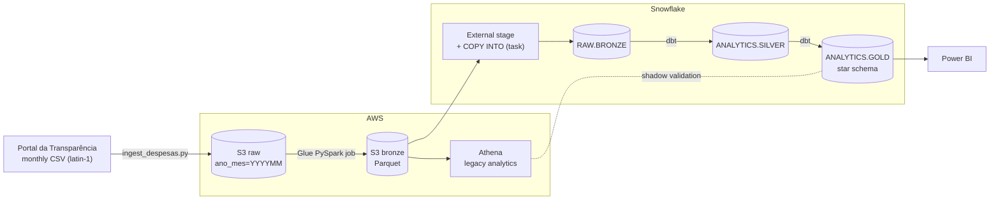
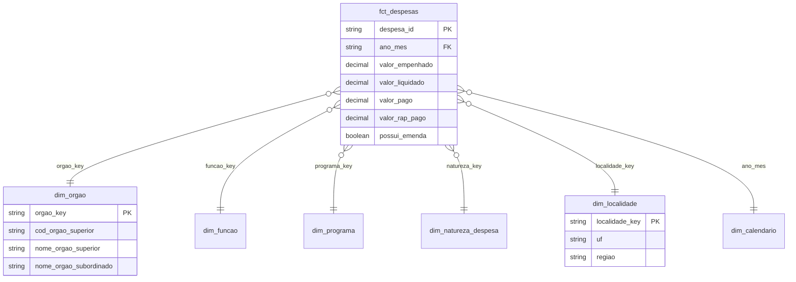

# Public Spending Data Platform — AWS Lakehouse → Snowflake Migration

[](https://github.com/vitorchavernue/public-spending-data-platform/actions/workflows/ci.yml)

End-to-end data platform for **Brazilian federal public expenditure** (official monthly data from the
Portal da Transparência), covering the whole lifecycle of a real-world migration:

- **AWS lakehouse** — raw zone in **S3**, **Glue** (PySpark) job to a Parquet bronze layer, **Athena** as the legacy analytics engine
- **Migration to Snowflake** — storage integration, idempotent `COPY INTO`, cost-controlled warehouses and resource monitors
- **dbt** — medallion modeling (silver → gold), **star schema**, and **data quality tests**
- **Shadow validation** — legacy vs. new platform reconciliation with a **99.5% minimum adherence** gate
- **Cost analysis** — scan-based (Athena) vs. compute-based (Snowflake) pricing and guardrails
- **Infrastructure as code** (Terraform) and **CI** (GitHub Actions) running the full pipeline on real sample data

---

## 🎯 Business problem

A company keeps its analytical data in an **S3 data lake queried through Athena**. As usage grows, three problems appear:

| Problem | Impact |
|---|---|
| **Unpredictable cost** — recurring BI and analyst queries scan hundreds of MB to more than 100 GB each, several times a day, on large tables without effective partition filters | Athena bills per TB scanned, so the monthly bill grows with every new dashboard and user |
| **No single source of truth** — business metrics (committed, settled and paid amounts) are recalculated in different queries and reports | Different dashboards show different numbers for the same month, and trust in the data drops |
| **Risky migration** — moving to Snowflake is the obvious fix for cost, but there is no objective way to prove the numbers stay the same | The cut-over keeps being postponed, and both platforms keep generating cost |

## 💡 Solution

| Step | What was built | Problem solved |
|---|---|---|
| 1 | Standardized **raw → bronze** layer (S3 + Glue, Parquet partitioned by month) shared by both platforms | Same input data for legacy and new platform |
| 2 | **Workload-based migration** of the heavy, recurring queries to Snowflake, with one small warehouse per workload, 60 s auto-suspend and resource monitors | Cost becomes compute-based, predictable and capped |
| 3 | **Governed metric layer in dbt** (silver → gold star schema) with 35 data quality tests | One definition per metric, tested on every run |
| 4 | **Shadow validation** comparing Athena vs. Snowflake per month and agency, with a **99.5% adherence gate** | Objective, auditable cut-over criterion |
| 5 | **Terraform + CI** running the whole pipeline on real data at every push | Reproducible environments and no regressions |

## 📈 Results

- **Cost under control**: heavy workloads moved from per-TB-scanned billing to per-second compute with hard monthly limits (method and example in [docs/cost_analysis.md](docs/cost_analysis.md))
- **Consistent numbers**: Power BI reads a single tested gold layer instead of ad-hoc queries
- **Safe migration**: cut-over approved only with ≥ 99.5% adherence on every critical metric — the current run reaches **100%** on the sample data
- **Guardrails on the legacy side** too: per-query scan cutoff in the Athena workgroup and partition projection

---

## 🏗️ Architecture



| Layer | Where | What |
|---|---|---|
| **Raw** | S3 `raw/despesas/ano_mes=YYYYMM/` | Files exactly as published (auditable copy) |
| **Bronze** | S3 Parquet → Athena / `RAW.BRONZE.DESPESAS` | Standardized names, decimals cast, lineage columns, partitioned by month |
| **Silver** | `stg_despesas` | Typed, cleaned, standardized lines with a hashed natural key |
| **Gold** | `fct_despesas` + 6 dimensions, `agg_execucao_mensal` | Star schema for Power BI and the reconciliation dataset |

---

## 🔄 Pipeline

| Step | Component | Highlights |
|---|---|---|
| 1. Ingestion | [`ingestion/ingest_despesas.py`](ingestion/ingest_despesas.py) | Downloads/extracts monthly zips, lands raw files in S3 (or local) partitioned by month |
| 2. Raw → Bronze | [`glue/jobs/raw_to_bronze.py`](glue/jobs/raw_to_bronze.py) | latin-1 / `;` / decimal `,` parsing, dynamic partition overwrite (reprocess one month safely) |
| 3. Legacy analytics | [`athena/`](athena/) | Partition projection (no crawlers), legacy metric view, scan-cost report |
| 4. Load to Snowflake | [`snowflake/02_load_bronze.sql`](snowflake/02_load_bronze.sql) | Storage integration (no keys), idempotent `COPY INTO`, daily task, clustering by month |
| 5. Transform | [`dbt/`](dbt/) | Silver/gold models, surrogate keys, cross-database macros (Snowflake + DuckDB) |
| 6. Data quality | `dbt build` | 35 tests: unique/not null keys, relationships, accepted values, silver ↔ gold reconciliation, valid months |
| 7. Shadow validation | [`validation/shadow_validation.py`](validation/shadow_validation.py) | Key coverage + metric adherence per month and agency, divergence report, CI gate |
| 8. Consumption | Power BI | See the [Public Budget Execution Dashboard](https://github.com/vitorchavernue/public-budget-execution-powerbi) |

---

## 🧩 Gold data model



---

## ✅ Shadow validation (migration gate)

During the migration, Athena and Snowflake run in parallel. The validation compares, for each
**month × superior body**:

1. **Key coverage** — pairs present on both platforms
2. **Metric adherence** — `1 − Σ|legacy − new| / Σ|legacy|` for row count, committed, settled and paid amounts
3. **Divergence report** — largest differences, to investigate filters, nulls, casting or duplicated loads

The cut-over is approved only when every check is **≥ 99.5%**. In CI the legacy side re-parses the
**raw files independently**, so the whole pipeline (bronze + dbt) is verified end to end on every push.

```
| Check                                | Adherence |
|--------------------------------------|-----------|
| Key coverage (month x superior body) | 100.0000% |
| qtd_lancamentos                      | 100.0000% |
| valor_empenhado                      | 100.0000% |
| valor_liquidado                      | 100.0000% |
| valor_pago                           | 100.0000% |
Result: APPROVED
```

---

## 💰 Cost

Athena bills **per TB scanned**; Snowflake bills **per second of warehouse time**. Recurring heavy
queries over large tables are the workloads that justify migration; light, well-partitioned queries
stay on Athena. Guardrails: Athena workgroup **scan cutoff**, **partition projection**, one small
warehouse per workload with **60 s auto-suspend**, and **resource monitors**.
Details and the decision method: [docs/cost_analysis.md](docs/cost_analysis.md).

---

## ▶️ Run locally (no cloud account needed)

Requires Python 3.11+. The local target runs the **same dbt models** on DuckDB.

```bash
pip install -r requirements.txt
make all        # lint → unit tests → ingest sample → bronze → dbt build → shadow validation
```

Or step by step:

```bash
python ingestion/ingest_despesas.py --input-dir sample_data/raw --target data/raw --clean
python local/build_bronze.py --raw data/raw --bronze data/bronze
cd dbt && BRONZE_PATH=../data/bronze dbt build --profiles-dir . --target local && cd ..
python validation/shadow_validation.py --legacy local --new local
```

## ☁️ Deploy on AWS + Snowflake

1. `cd infra/terraform && terraform apply` (S3, Glue job + schedule, Athena workgroup, IAM role for Snowflake)
2. `make package-glue` and upload `common.zip` to `s3://<bucket>/code/glue/`
3. Ingest: `python ingestion/ingest_despesas.py --months 202603 202604 --target s3://<bucket>/raw`
4. Athena: run [`athena/01_bronze_despesas.sql`](athena/01_bronze_despesas.sql) and [`02_legacy_execucao_mensal.sql`](athena/02_legacy_execucao_mensal.sql)
5. Snowflake: run [`snowflake/01_setup.sql`](snowflake/01_setup.sql) and [`02_load_bronze.sql`](snowflake/02_load_bronze.sql)
6. dbt: `pip install -r requirements-cloud.txt && cd dbt && DBT_TARGET=snowflake dbt build --profiles-dir .`
7. Validate: `python validation/shadow_validation.py --legacy athena --new snowflake`

Step-by-step migration plan: [docs/migration_runbook.md](docs/migration_runbook.md).

---

## 📁 Repository structure

```
├── ingestion/            # raw zone landing (S3 or local)
├── common/               # shared schema (raw → bronze column mapping)
├── glue/jobs/            # AWS Glue PySpark job: raw → bronze Parquet
├── local/                # DuckDB equivalent of the Glue job (laptop / CI)
├── athena/               # legacy layer DDL, legacy metrics view, scan-cost report
├── snowflake/            # setup (roles, warehouses, monitors), S3 load, cost monitoring
├── dbt/                  # silver/gold models, tests, cross-database macros
├── validation/           # shadow validation (legacy vs new)
├── infra/terraform/      # AWS infrastructure as code
├── tests/                # unit tests (pytest)
├── sample_data/raw/      # real sample of the official monthly files
└── docs/                 # cost analysis, migration runbook
```

## 🛠️ Tech stack

**AWS** (S3, Glue, Athena, IAM) · **Snowflake** · **dbt** · **PySpark** · **Python** · **SQL** · **DuckDB** · **Terraform** · **GitHub Actions** · **Power BI**

## 📄 Data source

[Portal da Transparência](https://portaldatransparencia.gov.br) — *Execução da Despesa* (federal government, open data).

## 👤 Author

**Vitor Chavernue** — Senior Data Engineer & Data Analyst
[LinkedIn](https://www.linkedin.com/in/vitorchavernue/) · [GitHub](https://github.com/vitorchavernue)
