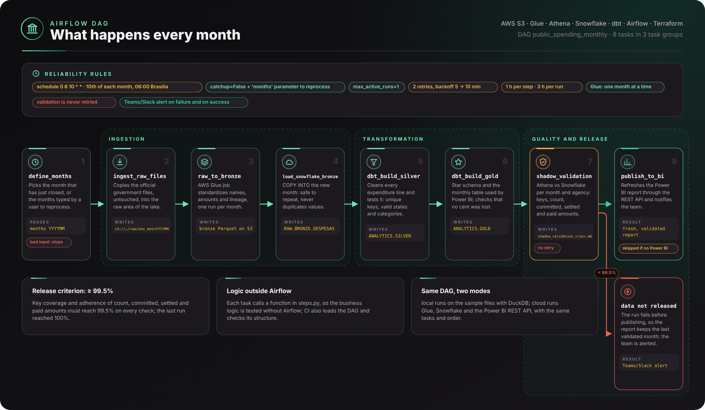
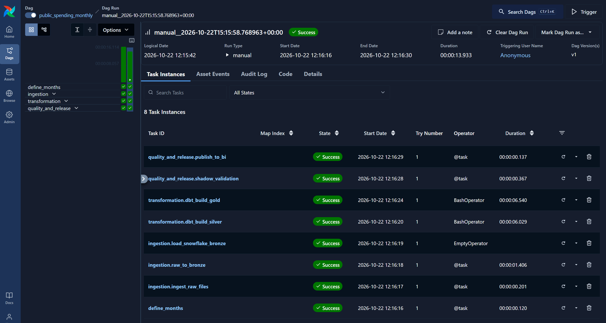
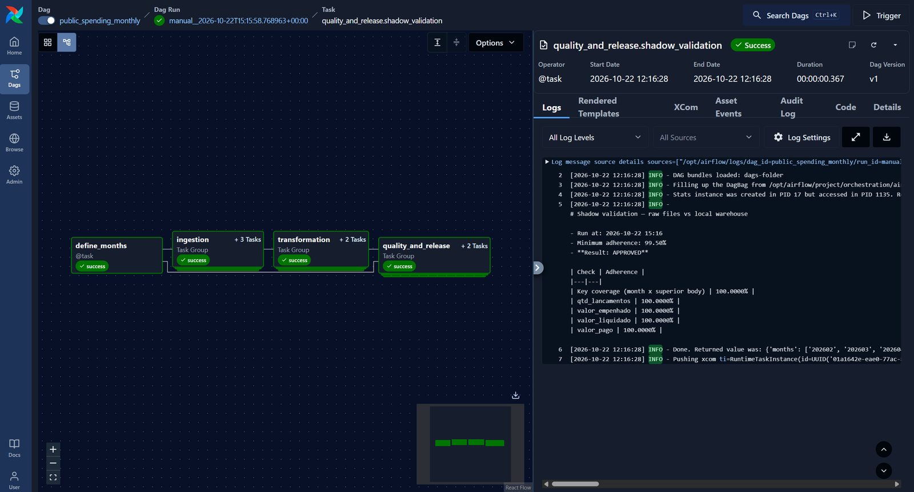

# Orchestration — Apache Airflow

The monthly load of public spending data is orchestrated by **Apache Airflow 3**. Airflow decides
**when** each step runs, **in which order**, what happens when something **fails**, and **who is alerted**.
The business logic of each step lives in [`steps.py`](steps.py), so it can be tested without Airflow.

## 📅 What happens every month



<sub>Generated by [`scripts/build_architecture.py`](../scripts/build_architecture.py) (SVG and PNG in `docs/images/`).</sub>

**A real run in the Airflow web interface** — the 8 steps finished on the first attempt in about 14 seconds (local mode):



The quality gate log: every check (key coverage, number of entries, committed, settled and paid amounts) matched the legacy platform, so the data was released:



| # | Step | What it does (plain words) | If it fails |
|---|---|---|---|
| 1 | `define_months` | Picks the month that has just closed, or the months typed by a user to reprocess | Stops immediately (bad input) |
| 2 | `ingest_raw_files` | Copies the official government files, untouched, into the raw area of the lake (S3) | Retries 2×, then alerts |
| 3 | `raw_to_bronze` | Standardizes the files (names, amounts, lineage) with **AWS Glue**, one run per month | Retries 2×, then alerts |
| 4 | `load_snowflake_bronze` | Loads the new month into **Snowflake** — safe to repeat, never duplicates values | Retries 2×, then alerts |
| 5 | `dbt_build_silver` | Cleans every expenditure line and **tests** it (unique keys, valid states and categories) | Retries 2×, then alerts |
| 6 | `dbt_build_gold` | Builds the star schema and the monthly table used by Power BI; checks no cent was lost | Retries 2×, then alerts |
| 7 | `shadow_validation` | Compares old (Athena) and new (Snowflake) numbers per month and agency | **No retry** — data is not released |
| 8 | `publish_to_bi` | Refreshes the **Power BI** report through the REST API and notifies the team | Skipped if Power BI is not configured |

## 🛡️ Reliability rules

| Rule | Why |
|---|---|
| Schedule: **10th of each month, 06:00 (Brasília)** | The previous month is already published; data is ready before the business day |
| `catchup=False` + manual `months` parameter | Past months are reprocessed on purpose, never by accident |
| `max_active_runs=1` | Two loads never write the same tables at the same time |
| 2 retries with exponential backoff (5 → 10 min) | Temporary problems (network, busy services) solve themselves |
| 1 h limit per step, 3 h per run | A stuck step is detected instead of running forever |
| Glue runs one month at a time (`max_active_tis_per_dag=1`) | The Glue job allows a single concurrent run |
| Validation is not retried | A difference in numbers does not fix itself; it must be investigated |
| Alerts on failure and on success (Teams/Slack webhook) | The team knows the status without opening Airflow |
| Gold table declared as an **Asset** | Other pipelines can start automatically when new data is published |

## ▶️ Run it

**One command, end to end, no server** (local mode, sample files):

```bash
make airflow-setup      # Airflow 3.1.8 + providers (official constraints) and dbt in its own environment
make airflow-test       # runs the whole monthly pipeline once
```

**With the Airflow web interface** (Docker):

```bash
cd orchestration/airflow
docker compose up --build
# open http://localhost:8080 → DAG "public_spending_monthly" → Trigger
```

**Cloud mode** (AWS + Snowflake): set `PSDP_TARGET=cloud` and configure

| Setting | Used by |
|---|---|
| Airflow connection `aws_default` (or IAM role), `AWS_REGION`, `DATA_LAKE_BUCKET`, `GLUE_JOB_NAME` | ingestion, Glue |
| Airflow connection `snowflake_default` + `SNOWFLAKE_*` variables for dbt | Snowflake load, dbt, validation |
| `ATHENA_RESULTS_S3`, `ATHENA_WORKGROUP` | shadow validation (legacy side) |
| `POWERBI_TENANT_ID`, `POWERBI_CLIENT_ID`, `POWERBI_CLIENT_SECRET`, `POWERBI_WORKSPACE_ID`, `POWERBI_DATASET_ID` | Power BI refresh |
| `ALERT_WEBHOOK_URL` (optional) | success and failure alerts |

With Airflow orchestrating the load, the Snowflake scheduled task in
[`snowflake/02_load_bronze.sql`](../snowflake/02_load_bronze.sql) is no longer needed and can stay suspended.

## 📁 Files

```
orchestration/
├── steps.py                         # business logic of each step (testable without Airflow)
└── airflow/
    ├── dags/public_spending_pipeline.py   # the DAG: schedule, order, retries, alerts
    ├── sql/copy_into_bronze.sql           # Snowflake load of the months being processed
    ├── Dockerfile, docker-compose.yaml    # local Airflow with the web interface
    ├── requirements-airflow.txt           # Airflow add-ons (installed with official constraints)
    └── requirements-dbt.txt               # dbt adapters, in a separate environment
```
